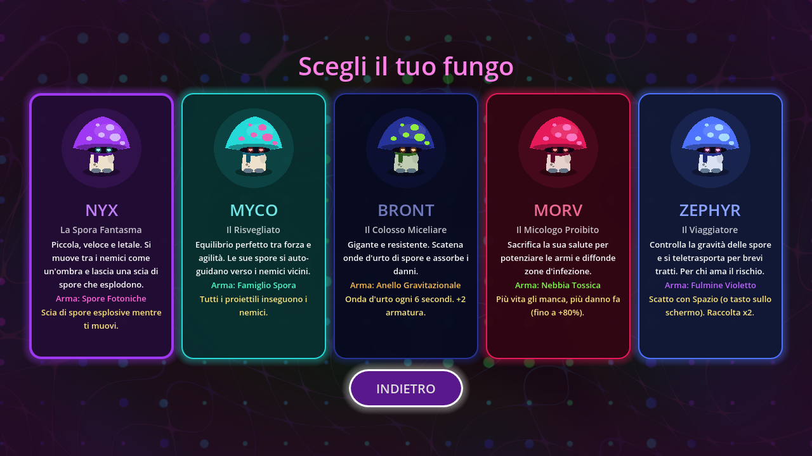

# MYCELIUM: Neon Abyss 🍄

Survivor psichedelico a tema funghi, in stile *Vampire Survivors*, fatto con **Godot 4.3**.

> Una rete miceliare antichissima collega ogni organismo del pianeta. Una civiltà ha tentato di controllarla per eliminare la morte, ma ha risvegliato una coscienza che altera la realtà. Tu sei un fungo mutato che ricorda solo frammenti.



## Come aprirlo sul Mac

1. Scarica **Godot 4.3** (versione standard, gratuita) da https://godotengine.org/download/macos/ e trascinalo in Applicazioni.
2. Scarica questo repository (su GitHub: **Code → Download ZIP**) ed estrailo.
3. Apri Godot, premi **Importa**, scegli il file `project.godot` nella cartella e conferma.
4. Premi **▶** in alto a destra (o `Cmd+B`) per giocare.

## Comandi

| Tasto | Azione |
| --- | --- |
| WASD / frecce | Muoversi (su telefono: trascina il dito) |
| 1 · 2 · 3 | Scegliere il potenziamento |
| Spazio | Scatto (solo Zephyr, su telefono c'è il tasto SCATTO) |
| P / Esc | Pausa |

## Cosa c'è

- **5 personaggi**, ognuno con arma iniziale, abilità e sinergia (+20% danno sull'arma iniziale):
  Nyx (scia di spore esplosive), Myco (proiettili auto-guidati), Bront (onda d'urto, armatura), Morv (più danno quando ha poca vita), Zephyr (scatto, raccolta doppia).
- **8 armi** fino al livello 8, ognuna con un'**evoluzione** che richiede il livello massimo più un potere specifico:

| Arma | Evoluzione | Potere richiesto |
| --- | --- | --- |
| Spore Fotoniche | Supernova Miceliare | Metabolismo Rapido |
| Lame di Micelio | Corona di Lame Dimensionali | Spore Concentrate |
| Nebbia Tossica | Eclissi della Peste | Espansione Mentale |
| Fulmine Violetto | Tempesta Prismatica | Terzo Occhio |
| Cristalli Fungini | Cattedrale di Cristallo | Cappello Robusto |
| Anello Gravitazionale | Singolarità Vivente | Micelio Magnetico |
| Radici Perforanti | Labirinto Divoratore | Muschio Curativo |
| Famiglio Spora | Sciame Cosciente | Gambo Veloce |

- **8 poteri passivi** fino al livello 5, massimo 6 armi e 6 poteri per partita.
- **Nemici**: Lumaca Acida, Zanzara Ronzante, Bruco Ipnotico, Occhio Fluttuante. Uno sciame ogni minuto, il boss **Re della Muffa** ogni 3 minuti.
- **Trama**: ogni boss sconfitto lascia un **frammento di memoria** (5 in tutto, salvati tra una partita e l'altra). Sopravvivendo 15 minuti si raggiunge il cuore della rete.
- Sfondo psichedelico fatto con uno shader, joystick touch, record salvato.

## Struttura del progetto

```
project.godot             configurazione (1280x720, orizzontale, renderer Compatibility per Android/iOS)
scenes/                   main.tscn (menu e flusso), game.tscn (partita)
scripts/core/data.gd      TUTTI i dati: personaggi, armi, evoluzioni, poteri, nemici, trama (autoload "Data")
scripts/game/             game.gd (ondate, esperienza, level up), player.gd, enemy.gd, projectile.gd,
                          gem.gd, pickup.gd, effects.gd, art.gd (disegni provvisori)
scripts/weapons/          weapon.gd (base) + un file per ogni arma, con la sua evoluzione
scripts/ui/               hud, level up, finestre di trama, joystick, anteprima personaggi
shaders/background.gdshader   sfondo psichedelico
assets/sprites/           qui vanno gli sprite definitivi
tests/simulate.gd         test automatico
prototipo-html/           il primo prototipo per browser (ignorato da Godot)
```

### Sprite definitivi

La grafica ora è disegnata a codice. Per sostituirla basta mettere dei PNG con sfondo trasparente in `assets/sprites/`:
`nyx.png`, `myco.png`, `bront.png`, `morv.png`, `zephyr.png` per i personaggi e `nemico_lumaca.png`, `nemico_zanzara.png`, `nemico_bruco.png`, `nemico_occhio.png`, `nemico_boss.png` per i nemici. Il gioco li usa in automatico.

### Test automatico

```
godot --headless --path . -s tests/simulate.gd --fixed-fps 60
```
Simula una partita con ogni personaggio, poi tutte le armi evolute, poi il game over. All'avvio Godot stampa un falso errore "Identifier not found: Data" (lo script di test viene compilato prima degli autoload): è innocuo, contano le righe `[ok]`.
